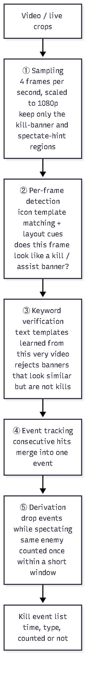
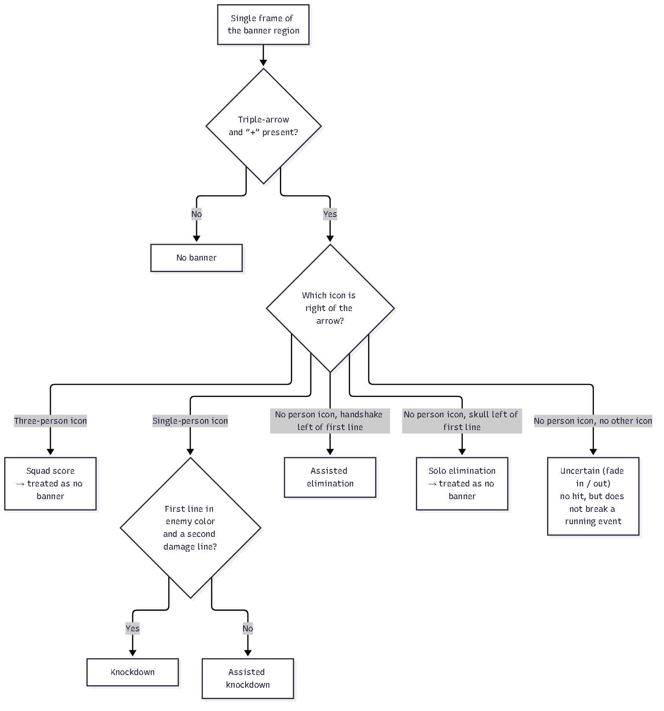
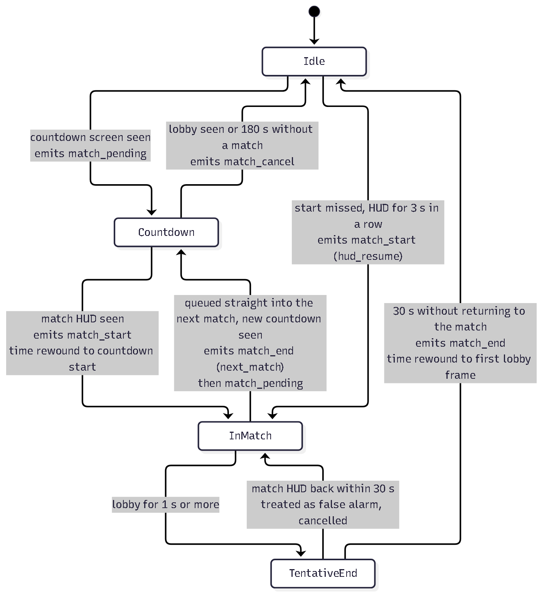
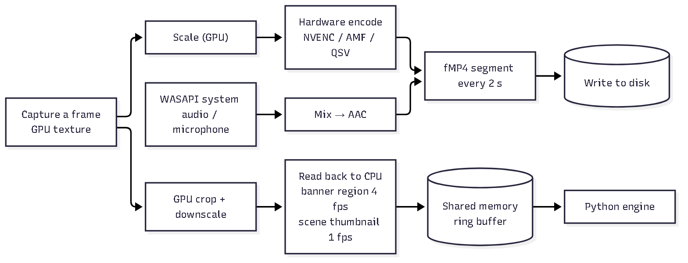

# Aditor

**English** ｜ [繁體中文](README.zh-TW.md)

> **Automatic highlight recording, analysis and editing for Apex Legends**
>
> Record your *Apex Legends* matches, or drag in videos you already have. Aditor marks every knockdown and assist automatically, then lets you pick highlights on a timeline and export them. Everything runs locally on your PC from on-screen pixels only — no cloud, no game injection.

> [!IMPORTANT]
> **Supported modes: Battle Royale (casual) and Ranked only.** Wildcard, Team Deathmatch and other modes are not supported.

**Download:** [Releases](https://github.com/ShiQu1218/Aditor/releases) (Windows 10 / 11, 64-bit)

---

## Screenshots

Real recordings and saved analysis results, shown in the Traditional Chinese UI.

### Video library

Each recording shows its detected knockdowns, assists and highlights. For example, the 08:57 recording has **10 knockdowns and 4 assists**.

<p align="center"></p>

### Studio overview

The same recording has **14 recorded events**, marked across the timeline alongside the gameplay preview and suggested highlights.

<p align="center"></p>

### Event detail and editing

Zoom in to see individual knockdown and assist markers, then add a suggested highlight to the project for export.

<p align="center"></p>

---

## Features

| Feature | Description |
|---|---|
| Offline analysis | Drop in a recording (MP4 / MKV / MOV / WebM); knockdowns and assists are marked automatically |
| Spectate filter | Teammates' kills while you spectate after dying are not counted as yours |
| Built-in recording | Starts when Apex launches; "one file per match" or "start to finish" |
| OBS mode | OBS records, Aditor only detects and splits files |
| AI auto-compilation | Groups dense kills into multi-kill fight clips |
| Editing & export | Split, trim, reorder, undo, autosave; fast lossless or precise hardware re-encode |
| Multilingual UI | 繁體中文, 简体中文, English, 日本語, 한국어 |

---

## How it works

<p align="center"></p>

Three separate programs: the **Electron app** (UI), the **recorder `aditorrec`** (Rust, GPU capture and encoding) and the **analysis engine** (Python). A crash on one side never takes down the others.

### Kill detection

<p align="center"></p>

No machine learning — just template matching on the kill-banner icons, so it works in any game language. To reject lookalike banners, each video learns its own text templates from the first clear kills.

<p align="center"></p>

### Match segmentation

<p align="center"></p>

### Recording

<p align="center"></p>

Video stays on the GPU and only hardware encoders are used, so the impact on the game is small. Recording is written in 2-second segments: a crash loses at most 2 seconds, and in "one file per match" mode the lobby is not kept.

<sub>Diagram sources: [`docs/diagrams/src/`](docs/diagrams/src)</sub>

---

## Known limitations

- Only Battle Royale (casual) and Ranked are supported; Wildcard, Team Deathmatch and other modes are not.
- Only **knockdowns** and **assists** are detected; solo eliminations and squad wipes are not.
- The spectate filter recognizes the hint bar in Traditional/Simplified Chinese, English, Japanese and Korean only.
- Recording needs a hardware encoder (NVENC / AMF / QSV); without one nothing is recorded.
- Detection relies on the game's UI; a game update may require updated templates.
- Accuracy reports (Traditional Chinese): [`docs/accuracy-report-icon.md`](docs/accuracy-report-icon.md), [`docs/accuracy-report-matches.md`](docs/accuracy-report-matches.md).

---

## Building from source

Requires Node.js 20+, Python 3.11+ and the Rust stable toolchain.

```powershell
git clone https://github.com/ShiQu1218/Aditor.git
cd Aditor
python -m venv engine\.venv
.\engine\.venv\Scripts\python.exe -m pip install -e "engine[dev]" pyinstaller
npm --prefix app install
powershell -ExecutionPolicy Bypass -File scripts\build.ps1
```

The installer and portable build are written to `dist\`. Tests: `engine\.venv\Scripts\python.exe -m pytest -q` and `npm --prefix app test`.

---

## License

[GNU General Public License v3.0](LICENSE). The bundled FFmpeg is an LGPL v3 build; see [THIRD_PARTY_NOTICES.md](THIRD_PARTY_NOTICES.md).

*Apex Legends* is a registered trademark of Electronic Arts Inc. Aditor is an independent open-source tool, not affiliated with or endorsed by Electronic Arts Inc. or Respawn Entertainment.
