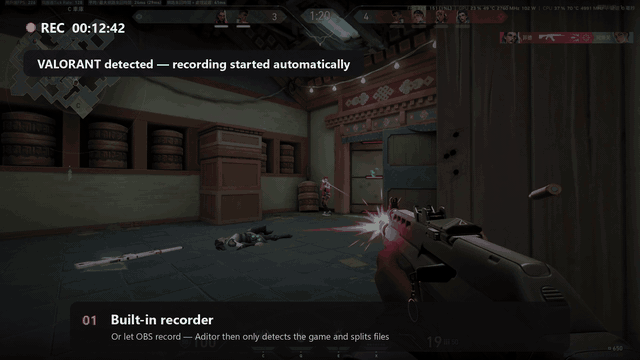
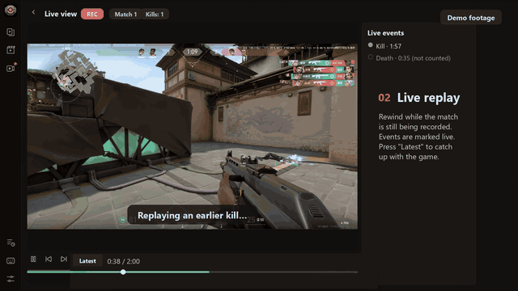
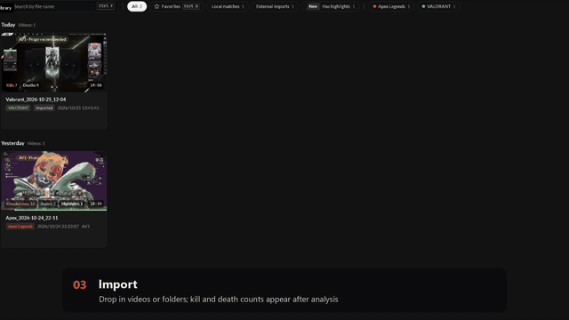
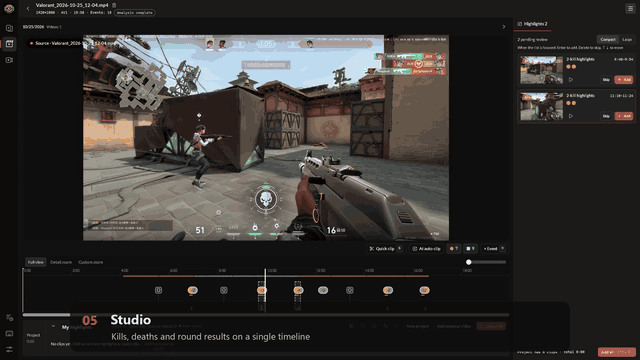
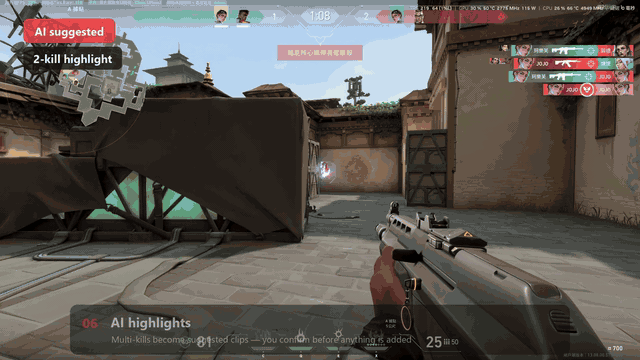
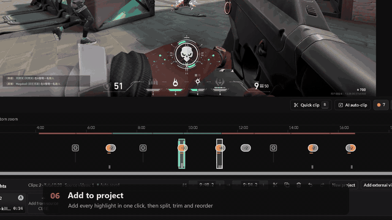
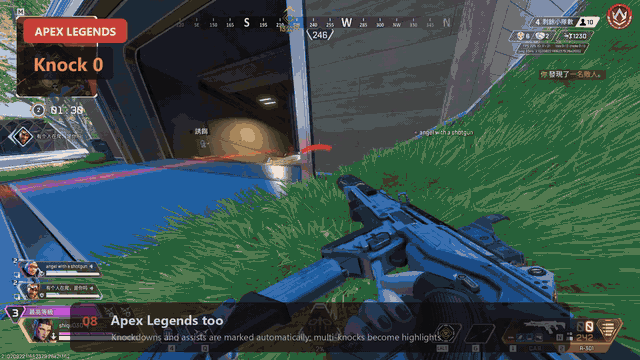
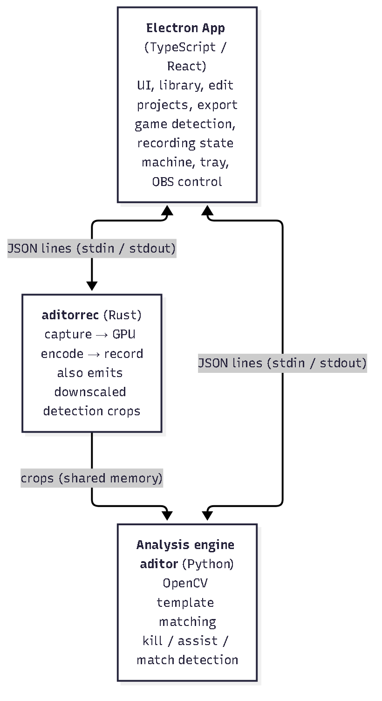

<p align="center"></p>

# Aditor

**English** ｜ [繁體中文](README.zh-TW.md)

> **Automatic highlight recording, analysis and editing for Apex Legends and VALORANT**
>
> Record your *Apex Legends* or *VALORANT* matches, or drag in videos you already have. Aditor marks every Apex knockdown and assist, or every VALORANT kill and death, automatically, then lets you pick highlights on a timeline and export them. Video processing runs locally on your PC from on-screen pixels only, without game injection. Filtered Sentry error and performance diagnostics are on by default and can be turned off in Settings; see [diagnostics details](docs/sentry.md).

**Download:** [Releases](https://github.com/ShiQu1218/Aditor/releases) (Windows 10 / 11, 64-bit; installer or portable build)

---

## Feature tour

Short clips of the main features, recorded from real VALORANT and Apex Legends footage.

**1. Built-in recorder** starts when a supported game launches.

<p align="center"></p>

**2. Live replay** lets you rewind while a match is still being recorded (demo footage).

<p align="center"></p>

**3. Import and analyze** detects the game and marks events from on-screen pixels only.

<p align="center"></p>

**4. Studio** shows kills, deaths and round results on one timeline.

<p align="center"></p>

**5. AI highlights** suggests multi-kill clips and you confirm each one.

<p align="center"></p>

**6. Export** with fast lossless cuts or precise re-encode.

<p align="center"></p>

**7. Apex Legends** knockdowns and assists are marked the same way.

<p align="center"></p>

---

## Screenshots

Real Apex Legends recordings and saved analysis results, shown in the Traditional Chinese UI.

### Video library

Each recording shows its detected knockdowns, assists and highlights. For example, the 08:57 recording has **10 knockdowns and 4 assists**.

<p align="center"></p>

### Studio overview

The same recording has **14 recorded events**, marked across the timeline alongside the gameplay preview and suggested highlights.

<p align="center"></p>

### Event detail and editing

Zoom in to see individual knockdown and assist markers, then add a suggested highlight to the project for export.

<p align="center"></p>

---

## What you can do

| Feature | Description |
|---|---|
| Import and analyze | Drag in recordings (MP4 / MKV / MOV / WebM), or add a **watch folder** so new videos are imported and queued for analysis automatically, one at a time |
| Automatic event marking | Apex knockdowns and assists, or VALORANT kills and deaths, are marked on the timeline. The game is recognized automatically; you can also pick it, or re-analyze a video as another game, from the video card |
| Highlights | Suggested highlights, AI auto-compilation of dense kills into multi-kill fight clips, and VALORANT multi-kill and ace highlights |
| VALORANT rounds | Round win/loss strip on the timeline |
| Spectate filter | Apex: teammates' kills while you spectate after dying are not counted as yours |
| Record gameplay | Built-in recorder starts when a supported game launches; choose "one file per match" or "start to finish" |
| Watch live | While a match is being recorded, open it in the Live view to watch it with events marked as they happen |
| Capture options | Window capture (WGC), screen capture (DDA) or an opt-in Hook capture (with a risk confirmation); automatic by default. Optional mouse cursor, system audio and microphone, and a choice of GPU on multi-GPU PCs |
| OBS mode | OBS records, Aditor only detects and splits files (via OBS WebSocket, with optional fallback to the built-in recorder) |
| Edit | Split, trim, reorder, undo, autosave; switch between same-day videos in the studio, and one project can draw clips from several source videos; proxy files for smoother preview of hard-to-decode videos |
| Export | One file per clip or a single compilation; **fast lossless** (keyframe cuts) or **precise re-encode** with NVENC / QSV / AMF, or optional CPU OpenH264 downloaded on request |
| Library | Filter by game and by recording or import source; remove videos directly from the studio |
| Everything else | Guided first-run onboarding, searchable settings, auto-update for the installer build, UI in 繁體中文, 简体中文, English, 日本語 and 한국어 |

---

## Quick start

1. Download `Aditor-Setup-<version>.exe` (installer, supports auto-update) or `Aditor-<version>-Portable.exe` from [Releases](https://github.com/ShiQu1218/Aditor/releases). The executables are not code signed, so Windows SmartScreen may warn you.
2. Follow the first-run onboarding. Then either drag existing recordings into the library, or set a watch folder in Settings.
3. To record, leave Aditor running and launch Apex Legends or VALORANT. Recording starts automatically and each match is analyzed afterwards. Choose the recording mode, capture method and OBS options in Settings.
4. Open a video in the Studio, review the marked events and suggested highlights, trim or reorder clips, and export.

---

## Supported games and modes

| Game | Detected | Notes |
|---|---|---|
| Apex Legends: Battle Royale (casual), Ranked, Wildcard | Knockdowns and assists | Solo eliminations and squad wipes add no extra kills; any game language (icon matching) |
| Apex Legends: Mixtape, Team Deathmatch | Kills and assists | Traditional Chinese and English text banners; Japanese kills only |
| Apex Legends: Mixtape, Control | Local-player kills from the top-right feed | Traditional Chinese only, verified on one recording; English Control and Control assists are unsupported |
| Other Apex Mixtape modes | Unverified | See the [validation scope](docs/accuracy-report-mixtape.md) |
| VALORANT | Kills, deaths, rounds, multi-kills, aces | Deathmatch records kills and deaths but has no rounds. 16:9, 16:10, 4:3 and 5:4 layouts |

## Requirements

- Windows 10 or 11, 64-bit.
- For recording: a GPU with a hardware encoder (NVENC / AMF / QSV). Analysis and export of existing videos do not need one (precise re-encode falls back to OpenH264 on request, and fast lossless needs no encoder).
- No runtime or FFmpeg install is needed; everything required is bundled.

---

## Known limitations

- **Apex Legends:** Team Deathmatch text banners support Traditional Chinese and English; Japanese supports kills only (no assist sample yet). Control local-player kills use the top-right feed, verified on one Traditional Chinese recording; English Control remains unsupported. Other languages, HUD configurations, Control assists and other Mixtape modes remain unverified.
- **Apex Legends:** Battle Royale and Wildcard detect **knockdowns** and **assists**; Mixtape also detects direct kills. BR solo eliminations and squad wipes do not produce additional kills.
- **Apex Legends:** the spectate filter recognizes the hint bar in Traditional/Simplified Chinese, English, Japanese and Korean only.
- **VALORANT:** detection assumes the default HUD position; overlays that cover the top-right kill feed can cause missed kills.
- **VALORANT:** playing in **borderless window** (windowed fullscreen) is recommended; in exclusive fullscreen the game window can pop up or minimize and disturb recording. Non-16:9 layouts such as 4:3 normally require exclusive fullscreen.
- **VALORANT:** per-match splitting relies on the Riot Client's unofficial local API, which a Riot update may break; when that happens the session is recorded as one file. An imported video that is not 16:9 and carries no Aditor aspect tag is analyzed as 16:9.
- Some interface text still says "Apex" even when the video is another game.
- Recording needs a hardware encoder (NVENC / AMF / QSV); without one nothing is recorded.
- Hook capture loads OBS's game-capture component into the game process; the game publisher has not stated whether this is permitted, so it is opt-in only. Read the in-app warning first.
- Detection relies on the game's UI; a game update may require updated templates.
- Accuracy reports (Traditional Chinese): [`docs/accuracy-report-icon.md`](docs/accuracy-report-icon.md), [`docs/accuracy-report-matches.md`](docs/accuracy-report-matches.md).

---

## Resource usage measurements

Two local Windows sessions were measured on October 20, 2026 (UTC+8), with the recording bitrate set to **40,000 kbps (40 Mbps)**. Values cover Aditor and its child processes, including the recorder and analysis engines; they exclude the game and unrelated apps. These are observations from one PC. Hardware, recording resolution, frame rate and codec were not saved in the monitoring logs, so the results are not an RTX 3060 benchmark or a comparison with other recorders.

| Metric | 9 min 17 sec: average / peak | 60 min: average / peak |
|---|---|---|
| CPU, normalized to the whole machine | 0.75% / 2.52% | 0.72% / 8.70% |
| Resident working set, summed | 773 / 810 MiB | 962 / 1,397 MiB |
| Private committed memory | 1,884 / 1,904 MiB | 1,995 / 2,412 MiB |
| Process write I/O | 7.05 / 20.58 MiB/s | 15.01 / 606.10 MiB/s |
| GPU VideoEncode engine utilization, summed | 5.52% / 10% | Not collected |

The short session ran from 13:30:37 to 13:39:55 (552 samples, approximately one second apart); the long session ran from 14:00:08 to 15:00:08 (720 samples, approximately five seconds apart). Averages are arithmetic means of available samples. CPU and I/O rates exclude the initial sample without a baseline.

During the hour-long session, the recorder and live analysis engine showed about **4.2 MiB** and **1.0 MiB** of growth respectively, comparing the first and last three minute-window medians after five minutes of warmup. One UI process rose from approximately 73 MiB to 408 MiB near minute 51, then fell to about 255 MiB and stayed there through the end. No process met the sustained-growth screening criteria, but the retained UI memory warrants checking across repeated equivalent operations; this test does not establish the absence of leaks.

Working-set sums can double-count shared pages. Private committed memory includes non-resident pages and is not physical RAM usage. Process I/O includes cached and device I/O, so its peaks are not physical disk throughput. GPU values sum encoder-engine counters rather than total GPU usage. Game FPS, frame times, recording frame drops and GPU memory were not measured; these results do not quantify gameplay impact.

---

## How it works (short version)

Aditor is three separate programs, so a crash in one never takes down the others: the **Electron app** (UI), the **recorder `aditorrec`** (Rust, GPU capture and hardware encoding, written in 2-second segments so a crash loses at most 2 seconds) and the **analysis engine** (Rust). Detection uses image processing only, with no machine learning: template matching on kill-banner icons for Apex (each video also learns its own text templates), and kill-feed markers plus scoreboard digits for VALORANT. VALORANT match boundaries while recording come from the Riot Client's read-only local API; Aditor never touches game memory.

<p align="center"></p>

More diagrams: [detection pipeline](docs/diagrams/pipeline.en.png), [banner decision](docs/diagrams/banner-decision.en.png), [match state machine](docs/diagrams/match-state.en.png), [recording pipeline](docs/diagrams/recording.en.png). Sources: [`docs/diagrams/src/`](docs/diagrams/src). Accuracy and design notes live in [`docs/`](docs).

---

## Building from source

Requires Node.js 20+ and the Rust stable toolchain. Python is optional for [evaluation tools](tools/README.md).

The engine and recorder are separate Rust executables. Cargo.lock pins dependencies; run `scripts/test.ps1 -Tier full` before releasing.

```powershell
git clone https://github.com/ShiQu1218/Aditor.git
cd Aditor
cargo build --release --manifest-path engine/Cargo.toml
npm --prefix app install
powershell -ExecutionPolicy Bypass -File scripts\build.ps1
```

The installer and portable build are written to `dist\`. Tests: `cargo test --manifest-path engine/Cargo.toml -- --test-threads=4` and `npm --prefix app test`.

---

## License

[GNU General Public License v3.0](LICENSE). The bundled FFmpeg is an LGPL v3 build; see [THIRD_PARTY_NOTICES.md](THIRD_PARTY_NOTICES.md).

*Apex Legends* is a registered trademark of Electronic Arts Inc. *VALORANT* and Riot Games are trademarks or registered trademarks of Riot Games, Inc. Aditor is an independent open-source tool, not affiliated with or endorsed by Electronic Arts Inc., Respawn Entertainment or Riot Games, Inc.
