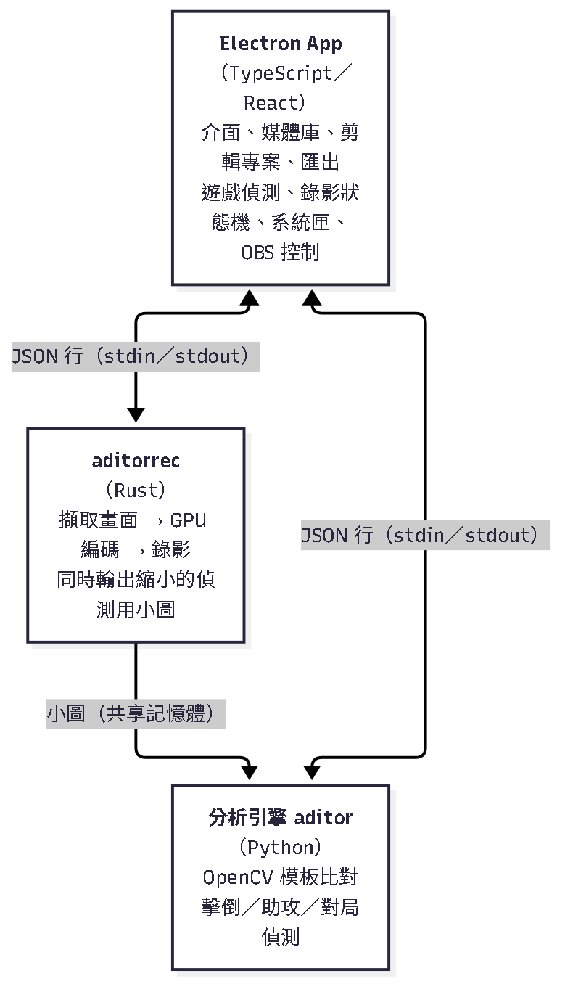
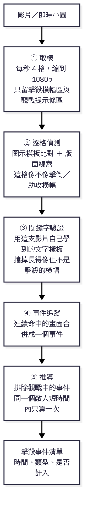
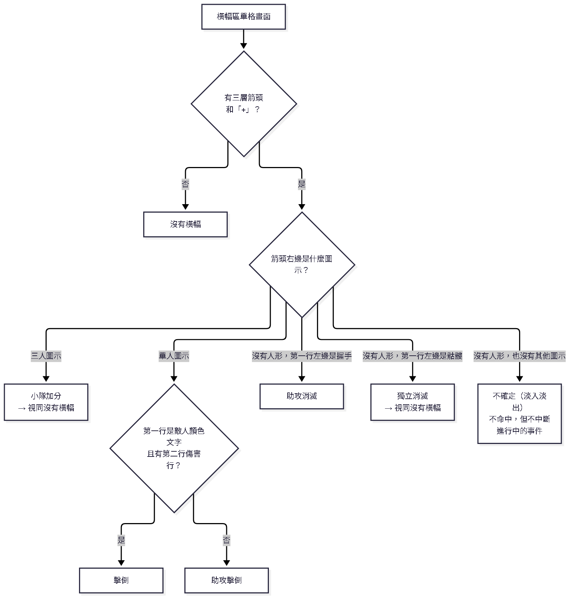
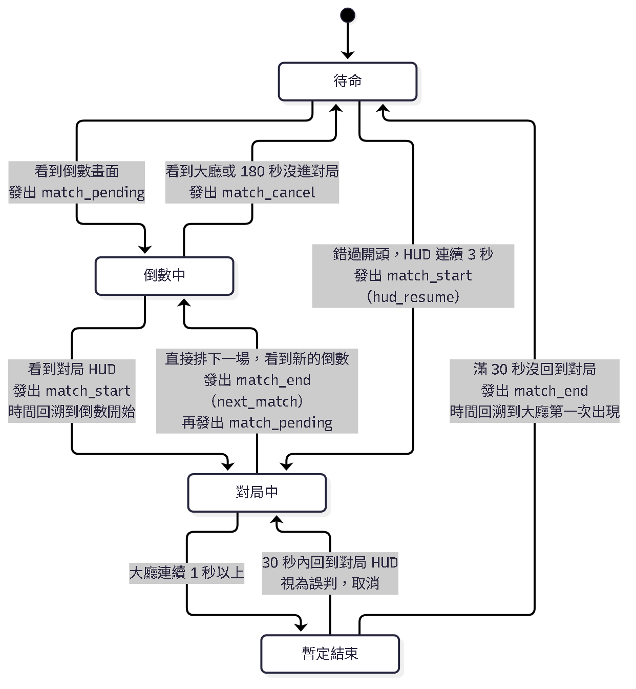
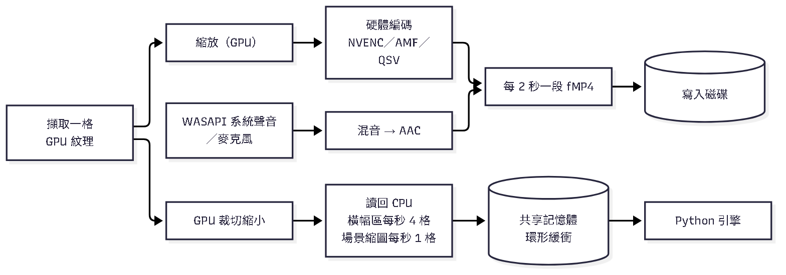

# Aditor

[English](README.md) ｜ **繁體中文**

> **Apex 英雄自動精彩時刻錄製、分析與剪輯工具**
>
> 在本機錄下《Apex 英雄》對局，或分析你現有的錄影，自動標出擊倒與助攻，再用時間軸與序列編輯器挑出精彩片段、匯出成檔。
> 全程只看畫面像素，不使用雲端服務，不需要上傳任何影片。

---

## 目錄

1. [它能做什麼](#它能做什麼)
2. [運作原理總覽](#運作原理總覽)
3. [辨識原理：怎麼看出擊倒與助攻](#辨識原理怎麼看出擊倒與助攻)
4. [對局切分原理：怎麼知道一局從哪裡開始](#對局切分原理怎麼知道一局從哪裡開始)
5. [錄影原理](#錄影原理)
6. [剪輯與匯出原理](#剪輯與匯出原理)
7. [準確度與已知限制](#準確度與已知限制)
8. [專案結構](#專案結構)
9. [系統需求](#系統需求)
10. [從原始碼建置](#從原始碼建置)
11. [授權與第三方說明](#授權與第三方說明)
12. [免責聲明](#免責聲明)

---

## 它能做什麼

| 功能 | 說明 |
|---|---|
| 離線分析 | 丟進任何 Apex 錄影（MP4／MKV／MOV／WebM），自動標出每一次擊倒與助攻 |
| 觀戰過濾 | 你陣亡後觀戰隊友時，隊友的擊倒不會算進你的精華 |
| 內建錄影 | 偵測到 Apex 就自動錄影，邊錄邊偵測，可選「一局一個檔」或「從頭錄到尾」 |
| OBS 模式 | 改由 OBS 負責錄影，本程式只做偵測與切檔 |
| 檢視器 | 時間軸、事件分佈、手動補記、快捷鍵 |
| AI 自動合輯 | 依擊倒密集度自動聚成多殺團戰片段 |
| 剪輯專案 | 分割、微調、排序、無限復原，自動儲存 |
| 匯出 | 快速無損（Stream Copy），或精準轉碼（硬體編碼） |
| 多語言介面 | 繁體中文、簡體中文、English、日本語、한국어；設定內可選「跟隨系統」或指定語言 |

---

## 運作原理總覽

整個軟體分成三個程式，各做一件事：

<p align="center"></p>

<sub>圖表原始碼：[`docs/diagrams/src/architecture.zh-TW.mmd`](docs/diagrams/src/architecture.zh-TW.mmd)</sub>

- **分析引擎（Python）**：只吃畫面，吐出「第幾秒發生了什麼事件」。離線分析與即時偵測用同一套判斷邏輯，差別只在畫面來源（影片解碼 vs. 錄影程式即時送來的小圖）。
- **錄影程式 aditorrec（Rust）**：擷取畫面、用顯示卡編碼成影片，並順手把偵測需要的小塊畫面縮小後放進共享記憶體給引擎讀。
- **Electron App**：把以上串起來，並提供所有操作介面。App 本身不碰影像資料。

兩個子程式都是獨立的 exe，用「一行一個 JSON」的文字協定溝通，所以任何一邊當掉都不會拖垮另一邊：引擎當掉，錄影照常進行，收尾後再補分析。

---

## 辨識原理：怎麼看出擊倒與助攻

### 先講結論：沒有用機器學習

整個辨識流程是傳統電腦視覺：**模板比對（OpenCV `matchTemplate`）、顏色遮罩、筆畫量測，加上人寫的規則與門檻**。沒有神經網路、沒有模型檔、不需要 GPU 做推論，也不需要標註資料。

好處是行為可解釋、出錯時能追到是哪一條規則；代價是依賴遊戲介面的固定外觀，遊戲改版時要重新調整樣板與門檻。

### 流程總覽

<p align="center"></p>

<sub>圖表原始碼：[`docs/diagrams/src/pipeline.zh-TW.mmd`](docs/diagrams/src/pipeline.zh-TW.mmd)</sub>

### ① 取樣：只看需要的地方

- 用 ffmpeg 解碼，**每秒取 4 格**（`FPS = 4`，事件時間精度 0.25 秒）。
- 不論原本是 1080p、1440p 還是 4K，一律先縮成 1920×1080，這樣所有座標與樣板尺寸都能固定。
- 只裁兩塊小區域，上下疊成一張小圖交給 Python：
  - **擊殺橫幅區**：畫面中下方 `(560, 700)`、大小 800×180，擊倒與助攻的提示出現在這裡。
  - **觀戰提示條區**：畫面左下角 `(60, 1028)`、大小 480×40。
- 能用顯示卡解碼時，畫面留在顯示卡記憶體裡，抽樣之後才搬回 CPU，省下大量複製。

### ② 逐格偵測：圖示優先，與語言無關

擊殺橫幅上的**文字**會隨遊戲語言變，但**圖示不會**。所以偵測主要靠這幾個圖示與版面線索：

| 線索 | 用途 |
|---|---|
| 分數右側的三層箭頭、箭頭左邊的「+」 | 所有「加分橫幅」都有；沒有這個就不是我們要的橫幅 |
| 箭頭右邊的**單人圖示** | 個人加分：擊倒、助攻擊倒 |
| 箭頭右邊的**三人圖示** | 小隊加分（小隊抹殺、復活等）→ 排除 |
| 第一行左邊的**握手圖示** | 助攻消滅 |
| 第一行左邊的**骷髏圖示** | 獨立消滅 → 排除 |
| 第一行下方有沒有**第二行細字** | 擊倒才有「傷害」那一行 |
| 第一行有沒有**敵人顏色的文字** | 擊倒的敵人名字是紅色（色盲模式為黃或粉紅）；助攻則是白字 |

每個圖示只有一張很小的灰階樣板（總共約 4 KB）。偵測時用 `matchTemplate` 在橫幅區找最像的位置、取相似度，再依門檻判斷：

- 有箭頭＋「+」＋單人圖示，且第一行是敵人色名字、有第二行 → **擊倒**
- 有箭頭＋「+」＋單人圖示，但第一行是白字 → **助攻擊倒**
- 第一行左邊是握手 → **助攻消滅**
- 其他（獨立消滅、小隊抹殺、復活、補給箱…）→ **視同沒有橫幅**

<p align="center"></p>

<sub>圖表原始碼：[`docs/diagrams/src/banner-decision.zh-TW.mmd`](docs/diagrams/src/banner-decision.zh-TW.mmd)</sub>

為了應付不同解析度造成的圖示大小差異，每支影片開頭會先**校準一次圖示尺度**（在 0.9～1.1 倍之間挑最適合的），之後都用單一尺度比對來保持速度。

### ③ 關鍵字驗證：樣板是影片自己「學」出來的

只靠圖示有一個漏洞：遊戲裡有些別的橫幅（例如「敵方小隊已消滅」）也用單人加分圖示。這時要靠**文字**區分，但不同語言的字長得完全不同，總不能每種語言都內建樣板。

做法是**從影片本身學**：

1. 掃描影片**開頭最多 900 秒**，挑出「有把握是擊殺」的橫幅當錨點：
   - 握手圖示分數很高的 → 助攻消滅錨點
   - 有傷害行、且讀得到像樣敵人名字的 → 擊倒錨點
2. 每種錨點取前 4 個橫幅，每個橫幅取 2 格，把第一行的筆畫圖（白色細筆畫的遮罩）取出。
3. **跨橫幅取平均**：不同橫幅的背景不同，平均後背景被抹掉，只剩每次都一樣的那幾個字，這就是這支影片的「關鍵字樣板」。
4. 之後每個候選橫幅都跟樣板比對（相似度 ≥ 0.7 才算命中）：
   - 命中助攻前綴 → 改判為助攻擊倒
   - 命中擊倒關鍵字 → 維持擊倒
   - 兩者都不中、而且有對應樣板 → 丟棄，判定不是擊殺橫幅

所以韓文、日文、簡中或其他語言的介面**不需要事先內建任何文字樣板**。代價有兩個：

- 每種樣板至少要有 **3 個不同的橫幅**才會啟用。如果影片開頭 900 秒幾乎沒有擊殺，就學不到，整支影片退回「只看圖示」，「敵方小隊已消滅」之類的橫幅比較可能被誤算。
- 學習只做一次，不會在 900 秒之後重學。

即時偵測是邊錄邊學：學習期間先把格子緩衝起來，學完再補判斷，結果與離線分析一致。

### ④ 事件追蹤：把連續命中合成一個事件

同一個橫幅會在畫面上停留約 2～10 秒，所以會連續命中很多格。`EventTracker` 把它們合成**一個事件**：

- 連續命中的格子（容許 1 格空白）屬於同一個 *run*；空白超過 0.5 秒（連續 2 格）就視為橫幅消失，下一次出現是新事件。
- run 的類型用**多數決**，因為橫幅淡入時圖示線索比較不準。
- 同一個 run 裡若敵人名字真的換了人（名字指紋改變，且中間有空白或分數凹陷），就切成兩個事件；單純被 HUD 遮擋造成的抖動則不切。
- 敵人名字用「指紋」比對：把名字區域的筆畫轉成一小張位元圖，比相似度，不做文字辨識。

### ⑤ 推導：決定哪些「算數」

對每個事件依序判斷：

1. 被使用者刪除 → 不計入。
2. 落在**觀戰區間**內 → 不計入（見下）。
3. **90 秒內，名字指紋相同的敵人只算第一筆**，其餘標為重複。助攻等沒有敵人名字的事件不參與去重。
4. 其餘 → 計入。

使用者也可以手動覆寫任何一個事件的計入狀態，重新分析時會依「同類型、時間差 ≤ 1 秒」保留這些手動修改。

### 觀戰過濾

你陣亡後會觀戰隊友，這時畫面上隊友的擊倒也會跳出同樣的橫幅，不能算成你的。判斷方法是看**左下角的操作提示條**（「顯示玩家旗幟」「下一位隊友」之類）：

- 提示條是文字，沒有圖示可用，所以這是整套偵測**唯一與語言有關**的地方。
- 目前內建樣板：繁中、簡中、英文、日文、韓文。**任一樣板命中就算觀戰**，不需要使用者選語言。
- 連續出現至少 2 秒才成立，成立後整段區間內的事件都不計入。
- 沒有樣板的語言偵測不到觀戰，觀戰中的擊倒會被算進去，只能手動取消計入。

### 與遊戲語言無關

因此除了觀戰提示條之外，擊殺偵測**不需要選擇語言**。圖示樣板只用英文、日文、簡中的錄影裁切，繁中與其他語言錄影只拿來驗收（沒有拿來調參數），確保不是只對某一種語言有效。

---

## 對局切分原理：怎麼知道一局從哪裡開始

「一局一個檔」「錄影中只留對局、不留大廳」都需要知道**對局的起訖**。這件事也不用機器學習，而是**場景分類 + 狀態機**。

### 場景分類

每秒取一張全畫面縮到 640×360 的灰階小圖，拿一組「固定介面元件」的樣板去比對，判斷現在是哪一種畫面：

| 場景 | 判斷依據（任一組同時成立） |
|---|---|
| `pre_match`（倒數／載入／選角） | 模式卡的箭頭 ＋ 載入頁腳（或外卡頁腳） |
| `lobby`（大廳） | 「準備」按鈕外框 ＋ 模式選擇外框 |
| `in_match_hud`（對局中） | 小地圖外框 ＋ 血量外框（含排位、觀戰的變形） |
| `other` | 都不是（包含結算畫面，結算頁籤另外記錄成「對局脈絡」） |

這些樣板比的是**外框與形狀**，不是文字，所以同樣與語言無關。

### 狀態機（MatchTracker）

分類結果一格一格餵進狀態機，由它發出四種事件：

<p align="center"></p>

<sub>圖表原始碼：[`docs/diagrams/src/match-state.zh-TW.mmd`](docs/diagrams/src/match-state.zh-TW.mmd)</sub>

幾個重點：

- **倒數階段就先發 `match_pending`**：這樣 OBS 或內建錄影器能從倒數、選角、運輸船開始保留，而不是等到落地看到 HUD 才開始。
- **確認是延遲的，但時間會回溯**：開局要等 HUD 出現才確定，結束要等大廳持續 30 秒沒回到對局才確定，確定後事件的時間戳會倒推回實際發生的時刻。
- **大廳不會立刻結束一局**：回到大廳常常馬上開獎勵、商店，也可能是誤判，所以給 30 秒緩衝，回到 HUD 就取消，避免一局被切成兩段。
- **取消**：倒數後如果回了大廳（取消配對）或 180 秒都沒進對局，發出 `match_cancel`。
- **錯過開頭**：如果錄影從對局中間開始，看到 HUD 連續 3 秒就視為對局開始（`hud_resume`）。

---

## 錄影原理

### 不注入、不讀記憶體

錄影用的是 Windows 公開的畫面擷取 API（與 OBS 同類），只讀取「畫面上的像素」：

- 不注入遊戲程序、不掛鉤、不讀取遊戲記憶體。
- 偵測 Apex 是否在執行只看程序名稱與視窗。

這是設計原則，但本專案無法為任何第三方反作弊系統的判定背書，請自行評估風險。

### 兩種擷取方式

| 方式 | 特性 |
|---|---|
| **DDA**（預設，Desktop Duplication） | 擷取整個螢幕，延遲較低、不影響滑鼠手感。代價：Apex 不在最前景時（例如你 Alt+Tab 去看別的視窗），錄到的 Apex 畫面會是**黑畫面**，這是刻意的，避免把別的視窗誤認成遊戲畫面 |
| **WGC**（Windows Graphics Capture） | 直接擷取 Apex 視窗，不受別的視窗遮蔽，但延遲略高 |

DDA 模式下，Apex 回到前景時才會重新有畫面；對局切分靠 HUD 連續出現 3 秒來恢復，所以你中途切出去再回來，仍會正確認出對局。

### 錄影管線

<p align="center"></p>

<sub>圖表原始碼：[`docs/diagrams/src/recording.zh-TW.mmd`](docs/diagrams/src/recording.zh-TW.mmd)</sub>

- **影像全程留在顯示卡**：只有給偵測用的小圖會搬到 CPU，所以對遊戲效能影響小。
- **只用硬體編碼**：依序嘗試 NVENC → AMF → QSV；**找不到硬體編碼器就不錄**，不會退回 CPU 編碼拖慢遊戲。
- **音訊**：系統聲音可選「只錄遊戲」（程序層級的 loopback），可另外混入麥克風。
- **共享記憶體**：16 個槽的環形緩衝，寫入端永遠不等讀取端；讀取端用前後序號檢查，撕裂的格子直接丟棄。引擎跟不上時只會跳格，不會拖慢錄影。

### 檔案存在哪裡

第一次啟動會有引導，讓你選一個根資料夾，並決定錄影模式（一局一個檔／從頭錄到尾）與錄影畫質（預設 1080p、60 fps、10000 kbps）。之後所有輸出都放在這個根資料夾底下的固定子資料夾：

```
<根資料夾>/
  Recordings/<YYYY-MM-DD>/Apex_….mp4    錄影，依日期分資料夾（一局跨午夜算開始那天）
  Exports/Merged/…                       剪輯輸出：合併成一支
  Exports/Clips/…                        剪輯輸出：一段一段分開輸出
```

資料夾名稱固定用英文，不隨介面語言改變，所以換語言不會讓路徑改變。暫存工作（見下）放在 `Recordings/.sessions/`。

### 為什麼切成 2 秒的片段

錄影不是寫成一個大檔，而是**每 2 秒一個 fMP4 片段**，每段第一格都是關鍵影格：

```
<根資料夾>/Recordings/.sessions/<工作編號>/
  init.mp4          初始化段
  seg_000001.m4s …  每段 2 秒
  index.jsonl       每寫完一段就追加一行，是唯一真相
  events.jsonl      即時偵測到的事件
  session.json      本次設定快照
```

這個設計一次解決好幾件事：

- **當機最多遺失 2 秒**：已寫完的片段都有效，App 下次啟動會掃描未收尾的工作並補收尾。
- **邊錄邊看**：播放器用 MSE 依索引逐段載入，時間軸跟著長，事件即時出現。
- **切檔不用重新編碼**：每段都從關鍵影格開始，所以挑出一堆片段直接串起來（stream copy）就是一個合法的影片。
- **可以事後刪除**：大廳片段直接刪檔就好（見下）。

### 兩種錄影模式

**從頭錄到尾**：Apex 關閉後把所有片段串成一個 `Apex_<日期_時間>.mp4`，事件含每局起訖。

**一局一個檔**：

- 每局輸出從**倒數前 5 秒**到**結束後 5 秒**，用完整片段做 stream copy。
- **大廳只暫存最近約 15 秒**：因為有人會掛機在大廳好幾個小時，全部存下來會塞爆磁碟。所以邊錄邊刪，只保留「最近 15 秒」、「正在進行的對局」與「倒數中的那段」。
- 只在即時偵測**確實在運作**時才刪（判斷依據是引擎每 5 秒回報的處理進度，而且刪除不會超過引擎已經分析過的時間），偵測壞掉就一律不刪，寧可多留也不漏錄。
- 整段錄影裡沒有任何對局，而且偵測全程正常 → 不輸出檔案（只待在大廳不會產生影片）。

### OBS 模式

如果你想用 OBS 的編碼設定，可以改由 OBS 錄影：

- 透過 OBS 內建的 WebSocket（v5）控制開始與停止，只走網路，不碰遊戲。
- `aditorrec` 仍然執行，但只擷取、輸出偵測小圖，不編碼；偵測流程與內建錄影相同。
- 「一局一個檔」時，OBS 在看到倒數（`match_pending`）時開始錄，開局確認後沿用同一個檔；倒數被取消就停止，這個檔不加進媒體庫。
- 如果 OBS 在你手動啟動錄影的狀態下被接管，本程式只沿用、絕不替你停止。

### 安全措施

- 每次錄影前與錄影中檢查磁碟空間，低於門檻會提醒，更低時停止並收尾已錄的部分。
- 遊戲啟動後等 20 秒才開始擷取，避開遊戲剛開啟時最容易出問題的時段。
- 所有關鍵步驟寫入診斷日誌 `%APPDATA%\Aditor\recording.log`（每行即時寫入磁碟），萬一當機可以事後追查。

---

## 剪輯與匯出原理

### AI 自動合輯

用計入的事件依下列規則自動產生片段（預設值可調）：

1. 相鄰擊殺間隔 ≤ 20 秒歸為同一群。
2. 一群至少要有 3 個擊殺才成立。
3. 片段範圍是 [第一殺 − 8 秒，最後一殺 + 4 秒]。
4. 超過 90 秒就在最大的擊殺間隔處切成兩段。
5. 重疊的片段能合併就合併，合併後太長就在重疊區中點分開。

### 剪輯專案

- 序列編輯器支援分割、微調、複製、拖曳排序與完整復原／重做。
- 專案自動儲存，下次啟動還原。
- 錄影中就能標記片段加進專案，收尾後自動改指向輸出檔。

### 匯出

| 模式 | 做法 | 特性 |
|---|---|---|
| **快速無損** | 從關鍵影格開始直接複製串流 | 幾乎瞬間完成、沒有畫質損失；切點會對齊到關鍵影格 |
| **精準轉碼** | 重新編碼，切點精準到毫秒 | 較慢；支援 NVENC、QSV、AMF 硬體編碼，以及 OpenH264 的 CPU 編碼 |

---

## 準確度與已知限制

- 只偵測**擊倒**與**助攻**（助攻擊倒、助攻消滅）；獨立消滅與小隊抹殺不偵測。
- 已知誤判：舊版遊戲（約 2026-07 以前）的「敵方小隊已消滅」橫幅也用單人加分圖示；沒有學到關鍵字樣板時會被算進去。
- 觀戰過濾只支援繁中、簡中、英文、日文、韓文的提示條。
- 圖示判斷依賴遊戲介面的固定外觀，遊戲改版可能需要更新樣板。
- 準確度數字與測試方式：[`docs/accuracy-report-icon.md`](docs/accuracy-report-icon.md)（圖示偵測）、[`docs/accuracy-report-matches.md`](docs/accuracy-report-matches.md)（對局切分）。
- 樣板來源與訓練／驗收分割：[`templates/icons/PROVENANCE.md`](templates/icons/PROVENANCE.md)。

---

## 專案結構

```
app/        Electron App（main：錄影狀態機、OBS、匯出、媒體庫；renderer：React 介面）
engine/     Python 分析引擎 aditor（圖示偵測、事件追蹤、場景分類、對局狀態機、即時模式）
recorder/   Rust 錄影程式 aditorrec（擷取、硬體編碼、音訊、共享記憶體）
templates/  圖示樣板（icons）與場景樣板（scene）
scripts/    建置腳本（build.ps1、fetch-ffmpeg.ps1）
tools/      樣板擷取與準確度驗收工具
docs/       準確度報告與設計文件
```

---

## 系統需求

- **作業系統**：Windows 10 / 11 64-bit
- **顯示卡**：錄影功能需要支援硬體編碼的顯示卡（NVIDIA NVENC、AMD AMF 或 Intel QSV）；只做離線分析與剪輯則不需要
- **記憶體**：建議 8 GB RAM 以上
- **視訊解碼**：支援 H.264、HEVC、VP9、AV1（內建 dav1d 解碼器）
- **儲存空間**：安裝約 300 MB，錄影另需空間

---

## 從原始碼建置

### 前置需求

- **Node.js**：v20 或以上（建議 v24 LTS）與 npm
- **Python**：v3.11 或以上
- **Rust**：stable toolchain（建置錄影程式用）
- **PowerShell**：Windows 內建即可

### 建置步驟

1. 取得原始碼：
   ```bash
   git clone https://github.com/ShiQu1218/Aditor.git
   cd Aditor
   ```

2. 設定 Python 虛擬環境並安裝引擎相依套件：
   ```powershell
   python -m venv engine\.venv
   .\engine\.venv\Scripts\python.exe -m pip install -e "engine[dev]" pyinstaller
   ```

3. 安裝前端相依套件：
   ```powershell
   cd app
   npm install
   cd ..
   ```

4. 執行一鍵建置腳本：
   ```powershell
   powershell -ExecutionPolicy Bypass -File scripts\build.ps1
   ```
   腳本依序完成：
   - 用 PyInstaller 建置引擎（`build\engine\aditor\`）
   - 下載並驗證 LGPL 版 FFmpeg（`build\ffmpeg\`）
   - 編譯 Rust 錄影程式
   - 編譯前端並用 `electron-builder` 打包安裝檔與免安裝版（輸出到 `dist\`）

   只改了 App、沒動引擎與 FFmpeg 時，可加 `-SkipEngine -SkipFfmpeg` 加快速度。

   FFmpeg 固定為 BtbN 的具名 autobuild（版本與 SHA-256 寫在 `scripts\fetch-ffmpeg.ps1`），下載檔雜湊不符時腳本會**失敗**而不是警告；若下載到舊版壓縮檔，請先刪除再重跑。

### 發版前檢查清單

1. 先跑測試：
   - `engine\.venv\Scripts\python.exe -m pytest -q`（設定 `ADITOR_GOLDEN_VIDEO` 才會真的執行 golden 測試）
   - `npm --prefix app test`
   - `npm --prefix app run typecheck`
   - `npm --prefix app run test:e2e`
2. 把舊的 `dist\`、`build\engine`、`build\pyinstaller-temp` 搬到備份位置，避免舊產物混入，再執行 `scripts\build.ps1`。
3. 檢查產物：
   - `dist\win-unpacked\resources\templates\icons\` 含 `profile.json`、6 張圖示與全部觀戰樣板，且內容與 git 相同。
   - `dist\win-unpacked\resources\engine\aditor\aditor.exe ipc` 的 ready 訊息中，`engine_version` 為 `0.3.0`。
   - `ffmpeg.exe -buildconf` 沒有 `--enable-gpl`、`--enable-nonfree`，有 `--enable-version3` 與 `--enable-libdav1d`。
   - 安裝檔內含 `THIRD_PARTY_NOTICES.md` 與 `LICENSE`。
4. 引擎 0.3.0 / icons@1 起改為圖示偵測；舊版（文字關鍵字法）產生的快取會自動重新分析，使用者的刪除與覆寫依「同類型、時間差 ≤ 1 秒」保留。

---

## 授權與第三方說明

- 本專案核心原始碼依據 [MIT 授權條款](LICENSE) 開源發布。
- 打包隨附的 FFmpeg 執行檔與動態連結函式庫為 **LGPL v3** 建置（`--enable-version3`，無 `--enable-gpl`／`--enable-nonfree`），其中的 libopenh264 為原始碼編譯，而非 Cisco 官方二進位。詳細的第三方套件與授權宣告請參閱 [THIRD_PARTY_NOTICES.md](THIRD_PARTY_NOTICES.md)。

---

## 免責聲明

《Apex 英雄》（Apex Legends）為 Electronic Arts Inc. 之註冊商標。
Aditor 為獨立開發之開源工具，非 Electronic Arts Inc. 或 Respawn Entertainment 所官方授權、贊助或附屬之軟體。
