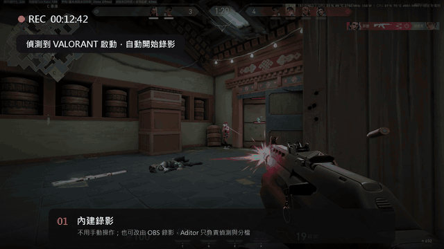
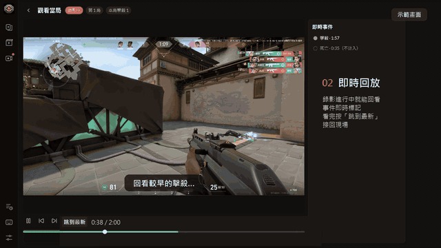
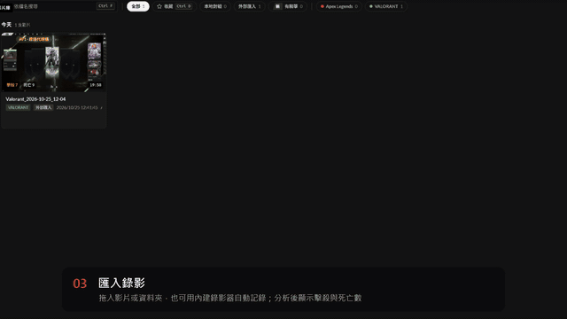
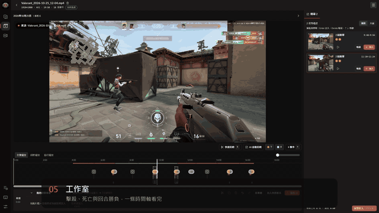
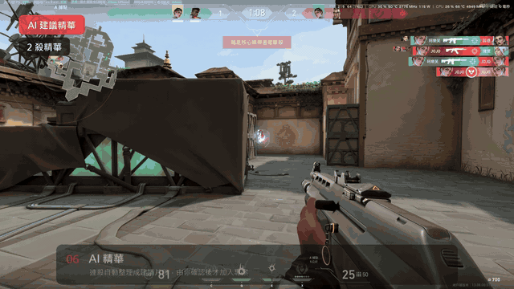
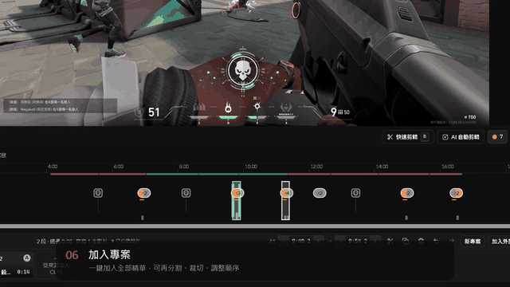
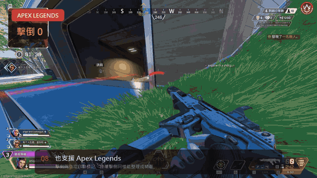
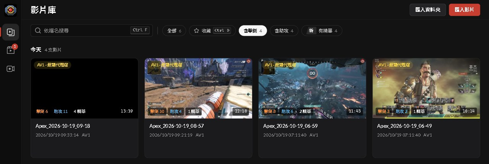
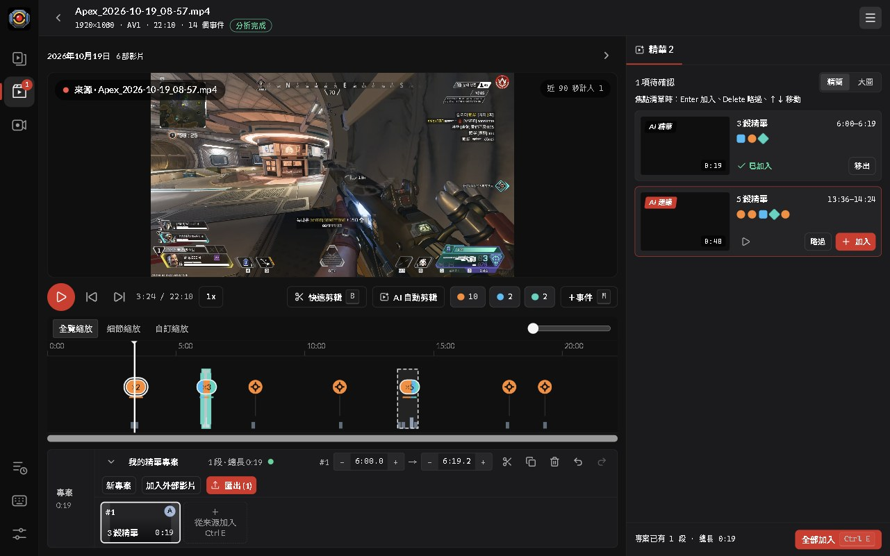
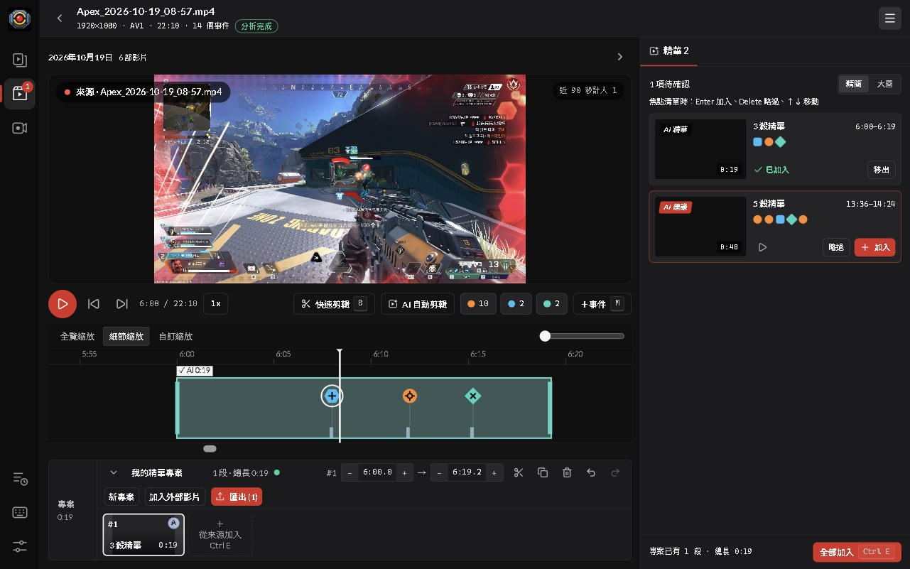

<p align="center"></p>

# Aditor

[English](README.md) ｜ **繁體中文**

> **Apex Legends 與 VALORANT 精彩片段自動錄影、分析與剪輯工具**
>
> 錄下你的 *Apex Legends* 或 *VALORANT* 對局，或直接拖入手上已有的遊戲影片。Aditor 會自動標出 Apex 的每一次擊倒與助攻，或 VALORANT 的每一次擊殺與死亡，讓你在時間軸上挑選精彩片段並匯出。影片處理全部在你的電腦上完成，只看畫面像素，不注入遊戲。過濾後的 Sentry 錯誤與效能診斷預設啟用，可在設定關閉；詳見[診斷說明](docs/sentry.md)。

**下載：** [Releases](https://github.com/ShiQu1218/Aditor/releases)（Windows 10 / 11 64 位元；安裝版或免安裝版）

---

## 功能導覽

以下短片取自真實的 VALORANT 與 Apex Legends 影片。

**1. 內建錄影**：支援的遊戲啟動後自動開始錄影。

<p align="center"></p>

**2. 即時回放**：對局還在錄影時就能回看（示範畫面）。

<p align="center"></p>

**3. 匯入與分析**：自動辨識遊戲，只讀取畫面像素標出事件。

<p align="center"></p>

**4. 工作室**：擊殺、死亡與回合勝負顯示在同一條時間軸。

<p align="center"></p>

**5. AI 精華**：自動建議連殺片段，由你逐一確認。

<p align="center"></p>

**6. 匯出**：快速無損剪切，或精準重新編碼。

<p align="center"></p>

**7. Apex Legends**：擊倒與助攻以同樣方式標記。

<p align="center"></p>

---

## 介面預覽

以下使用 Apex Legends 的實際錄影與已儲存的分析結果，介面語言為繁體中文。

### 影片庫

每支錄影都會顯示偵測到的擊倒、助攻與精華數量。例如 08:57 的錄影已記錄 **10 次擊倒、4 次助攻**。

<p align="center"></p>

### 工作室全覽

同一支錄影共有 **14 個已記錄事件**，時間軸標出事件位置，並搭配遊戲畫面預覽與精華建議。

<p align="center"></p>

### 事件細節與剪輯

放大時間軸即可查看個別擊倒與助攻標記，再將建議精華加入專案，準備匯出。

<p align="center"></p>

---

## 你可以做什麼

| 功能 | 說明 |
|---|---|
| 匯入與分析 | 拖入錄影檔（MP4 / MKV / MOV / WebM），或設定**監看資料夾**，新影片會自動匯入並依序排隊分析，一次分析一支 |
| 自動標記事件 | 在時間軸標出 Apex 的擊倒與助攻，或 VALORANT 的擊殺與死亡。自動辨識遊戲，也可在影片卡上手動選擇，或改用另一個遊戲重新分析 |
| 精華片段 | 精華建議、AI 自動剪輯（把密集擊殺組成多殺團戰片段），以及 VALORANT 的多殺與 Ace 精華 |
| VALORANT 回合 | 時間軸上的回合勝負色帶 |
| 觀戰過濾 | Apex：陣亡後觀戰隊友時，隊友的擊殺不會算成你的 |
| 錄製遊戲 | 內建錄影在偵測到支援的遊戲啟動時開始錄；可選「一局一個檔」或「從頭錄到尾」 |
| 即時觀看 | 對局錄影進行中，可在「即時」畫面觀看並即時看到標記的事件 |
| 擷取選項 | 視窗擷取（WGC）、螢幕擷取（DDA），或需手動啟用並確認風險的 Hook 擷取；預設自動。可選擇是否錄製滑鼠游標、系統音訊與麥克風，多顯示卡電腦可指定由哪張顯示卡負責 |
| OBS 模式 | 由 OBS 錄影，Aditor 只負責偵測與切檔（透過 OBS WebSocket，可選擇連不上時改用內建錄影） |
| 剪輯 | 分割、修剪、排序、復原、自動儲存；可在工作室切換同日影片，一個專案可使用多支來源影片的片段；難以解碼的影片可產生代理檔以順暢預覽 |
| 匯出 | 每個片段一個檔，或合併成單一精華；**快速無損**（依關鍵影格切割）或使用 NVENC / QSV / AMF 的**精準重新編碼**，也可依提示下載 CPU 版 OpenH264 |
| 影片庫 | 可依遊戲、錄影或匯入來源篩選；可直接在工作室移除影片 |
| 其他 | 首次啟動引導、可搜尋的設定、安裝版自動更新，介面支援繁體中文、简体中文、English、日本語、한국어 |

---

## 快速開始

1. 到 [Releases](https://github.com/ShiQu1218/Aditor/releases) 下載 `Aditor-Setup-<版本>.exe`（安裝版，支援自動更新）或 `Aditor-<版本>-Portable.exe`（免安裝版）。執行檔未經程式碼簽章，Windows SmartScreen 可能會顯示警告。
2. 依照首次啟動引導完成設定，然後把現有錄影拖進影片庫，或在設定中指定監看資料夾。
3. 想錄影的話，讓 Aditor 保持執行，再啟動 Apex Legends 或 VALORANT 即可自動開始錄製，每場對局結束後會自動分析。錄影模式、擷取方式與 OBS 選項都在設定中調整。
4. 在工作室開啟影片，檢視標記的事件與精華建議，修剪或排序片段後匯出。

---

## 支援的遊戲與模式

| 遊戲 | 偵測內容 | 備註 |
|---|---|---|
| Apex Legends：大逃殺（快速對戰）、積分、外卡 | 擊倒與助攻 | 單獨淘汰與滅隊不另計擊殺；以圖示比對，不受遊戲語言限制 |
| Apex Legends：娛樂模式、團隊死鬥 | 擊殺與助攻 | 支援繁體中文與英文文字提示 |
| Apex Legends：娛樂模式、控制 | 右上角紀錄中的本人擊殺 | 僅繁體中文，已用一支影片驗證；不支援英文控制與控制模式助攻 |
| 其他 Apex 娛樂玩法 | 尚待驗證 | 詳見[驗證範圍](docs/accuracy-report-mixtape.md) |
| VALORANT | 擊殺、死亡、回合、多殺、Ace | 死鬥會記錄擊殺與死亡，但沒有回合。支援 16:9、16:10、4:3、5:4 |

## 系統需求

- Windows 10 或 11，64 位元。
- 錄影需要具備硬體編碼器的顯示卡（NVENC / AMF / QSV）。分析與匯出現有影片則不需要（精準重新編碼可依提示改用 OpenH264，快速無損不需要編碼器）。
- 不需另外安裝 Python、Node.js 或 FFmpeg，全部已內建。

---

## 已知限制

- **Apex Legends：** 團隊死鬥的純文字提示支援繁體中文與英文；控制模式以右上角紀錄偵測本人擊殺，已用一支繁體中文影片驗證，英文控制仍不支援。其他語言、HUD 配置、控制模式助攻及其他娛樂玩法尚未驗證。
- **Apex Legends：** 大逃殺與外卡偵測**擊倒**與**助攻**；娛樂模式另偵測直接擊殺。單獨淘汰與滅隊不另計為大逃殺擊殺。
- **Apex Legends：** 觀戰過濾只認得繁中、簡中、英文、日文、韓文的提示列。
- **VALORANT：** 偵測假設 HUD 位於預設位置；有疊加物蓋住右上角的擊殺列表時，可能漏抓擊殺。
- **VALORANT：** 建議使用**無邊框視窗**（視窗化全螢幕）遊玩；獨佔全螢幕時，遊戲視窗可能不斷跳出或被最小化而干擾錄影。4:3 等非 16:9 比例通常只能在獨佔全螢幕下使用。
- **VALORANT：** 逐局切檔依賴 Riot Client 的非官方本機 API，Riot 改版後可能失效，失效時會整段錄成一個檔。匯入的影片若不是 16:9 且沒有 Aditor 的比例標記，會被當成 16:9 分析。
- 部分介面文案仍寫「Apex」，即使影片屬於另一個遊戲。
- 錄影需要硬體編碼器（NVENC / AMF / QSV），沒有就不錄。
- Hook 擷取會把 OBS 的遊戲擷取元件載入遊戲程序；遊戲發行商未說明是否允許，因此僅供手動啟用，請先閱讀程式內的警告。
- 偵測依賴遊戲介面外觀，遊戲改版後可能需要更新樣板。
- 準確率報告：[`docs/accuracy-report-icon.md`](docs/accuracy-report-icon.md)、[`docs/accuracy-report-matches.md`](docs/accuracy-report-matches.md)。

---

## 資源占用實測

於 **2026 年 10 月 20 日（UTC+8）**在同一台 Windows 電腦進行兩次量測，錄影位元率設定為 **40,000 kbps（40 Mbps）**。數據涵蓋 Aditor 及其子程序，包含錄影器與分析引擎，不含遊戲及其他軟體。監控紀錄未保存硬體型號、錄影解析度、FPS 與編碼格式，因此這些結果不代表 RTX 3060 效能，也不作為不同錄影軟體的排名依據。

| 項目 | 9 分 17 秒：平均／最高 | 60 分鐘：平均／最高 |
|---|---|---|
| CPU（以整台電腦為 100%） | 0.75%／2.52% | 0.72%／8.70% |
| 常駐記憶體合計 | 773／810 MiB | 962／1,397 MiB |
| 私有認可記憶體 | 1,884／1,904 MiB | 1,995／2,412 MiB |
| 程序寫入 I/O | 7.05／20.58 MiB/s | 15.01／606.10 MiB/s |
| GPU 編碼引擎使用率加總 | 5.52%／10% | 未收集 |

短時間測試為 13:30:37～13:39:55，共 552 次取樣，間隔約 1 秒；長時間測試為 14:00:08～15:00:08，共 720 次取樣，間隔約 5 秒。平均值為有效取樣的算術平均；CPU 與 I/O 速率排除沒有比較基準的首筆取樣。

一小時測試排除前 5 分鐘暖機後，以最初與最後各三個一分鐘視窗的記憶體中位數比較，錄影器與即時分析引擎分別增加約 **4.2 MiB** 與 **1.0 MiB**。其中一個介面程序在第 51 分鐘附近從約 73 MiB 升至 408 MiB，之後降至約 255 MiB，並維持至結束。沒有程序符合持續增長的篩檢條件，但介面保留的記憶體仍需透過重複相同操作追蹤；本次測試不能證明完全沒有記憶體洩漏。

常駐記憶體合計可能重複計入共享頁面；私有認可記憶體包含未常駐的頁面，不等同實際 RAM 占用。程序 I/O 包含快取與裝置 I/O，尖峰不代表實體磁碟吞吐量。GPU 數值是編碼引擎計數器的加總，不是整張顯示卡使用率。未量測遊戲 FPS、幀時間、錄影掉幀及顯示記憶體，無法由此推算對遊戲流暢度的影響。

---

## 運作方式（簡版）

Aditor 由三個獨立程式組成，任一邊當掉都不會拖垮其他部分：**Electron App**（介面）、**錄影器 `aditorrec`**（Rust，GPU 擷取與硬體編碼，以 2 秒為一段寫入，當機最多損失 2 秒）與**分析引擎**（Python）。偵測只用影像處理，不使用機器學習：Apex 對擊殺橫幅上的圖示做樣板比對（每支影片還會自己學出文字樣板），VALORANT 則看擊殺列表標記與比分數字。VALORANT 錄影時的對局邊界來自 Riot Client 的唯讀本機 API，Aditor 不碰遊戲記憶體。

<p align="center"></p>

更多流程圖：[偵測流程](docs/diagrams/pipeline.zh-TW.png)、[橫幅判斷](docs/diagrams/banner-decision.zh-TW.png)、[對局狀態機](docs/diagrams/match-state.zh-TW.png)、[錄影流程](docs/diagrams/recording.zh-TW.png)。原始檔：[`docs/diagrams/src/`](docs/diagrams/src)。準確率與設計說明請見 [`docs/`](docs)。

---

## 從原始碼建置

需要 Node.js 20+、Python 3.11+ 與 Rust stable 工具鏈。

發版與 CI 使用 Python 3.12，透過 `engine/constraints.txt` 共用固定版本，包含間接相依套件。更新版本清單或 `engine/pyproject.toml` 的建置後端後，請在發版前執行 `scripts/test.ps1 -Tier full`。

```powershell
git clone https://github.com/ShiQu1218/Aditor.git
cd Aditor
python -m venv engine\.venv
.\engine\.venv\Scripts\python.exe -m pip install -c engine/constraints.txt -e "engine[dev]" pyinstaller
npm --prefix app install
powershell -ExecutionPolicy Bypass -File scripts\build.ps1
```

安裝檔與免安裝版輸出在 `dist\`。測試：`engine\.venv\Scripts\python.exe -m pytest -q` 與 `npm --prefix app test`。

---

## 授權

[GNU GPL v3.0 授權](LICENSE)。隨附的 FFmpeg 為 LGPL v3 版本，詳見 [THIRD_PARTY_NOTICES.md](THIRD_PARTY_NOTICES.md)。

*Apex Legends* 為 Electronic Arts Inc. 的註冊商標。*VALORANT* 與 Riot Games 為 Riot Games, Inc. 的商標或註冊商標。Aditor 為獨立開發的開源工具，與 Electronic Arts Inc.、Respawn Entertainment 及 Riot Games, Inc. 無任何關聯，亦未獲其授權或贊助。
